# C. Heuva Junior Secondary School Information System

This Django web application provides separate interfaces for administrators and
learners to manage learner records and handle common academic communications.
Users choose whether to sign in as an Admin or a Learner. Access to each
dashboard and its actions depends on the signed-in user's role.

Administrators can create, edit, view, and delete learner accounts; manage the
subject list; assign subjects to courses; update their own profile; send
learners notifications; and review learner leave requests and feedback. They
can approve or reject leave requests and reply to feedback. Learners can view
the subjects assigned to their course, but cannot add or manage subjects.

Learners can view and update their profile, see results recorded for their
account, view notifications from the administrator, submit leave requests, and
send feedback. Learners can check the status of their leave requests and read
administrator replies to their feedback.

The application also stores course/grade and session/term assignments, results,
and attendance records for its downloadable reports. The previous standalone
course/session management and attendance pages are not part of the interface.
Administrators can maintain course, session, result, and attendance records in
Django Admin; learners can be assigned a course and session when their account
is added or edited, and subjects can be assigned to a course.

[Front-end Template](http://adminlte.io "Admin LTE.io")


[Project Demo on YouTube](https://www.youtube.com/watch?v=kArCR96m7uo "School Information Management System Demo")

And if you like this project, then ADD a STAR ⭐️  to this project 👆
## Deployed to
https://smswithdjango.herokuapp.com/


## What the System Does

### Admin interface
- View dashboard summaries of the learner and subject records.
- Add learner accounts, edit learner details, and delete learner accounts.
- Add, edit, and delete subjects.
- Add, update, and manage learner subject results and scores.
- Update the administrator's own profile.
- Send notifications to learners.
- Review and approve or reject learner leave requests.
- Read learner feedback and send replies.
- Generate downloadable PDF school summaries, class lists, learner results, and attendance summaries.

### Learner interface
- View and update personal profile details.
- View subjects assigned to the learner's course.
- View results associated with the learner account.
- Read notifications sent by an administrator.
- Submit leave requests and view their status.
- Send feedback and read administrator replies.

Class lists, learner results, and attendance summaries are filtered by the
selected course/grade and session/term. The subject filter for learner results
is optional; when it is omitted, results for all subjects in the selected
course are included.


## 📸 ScreenShots

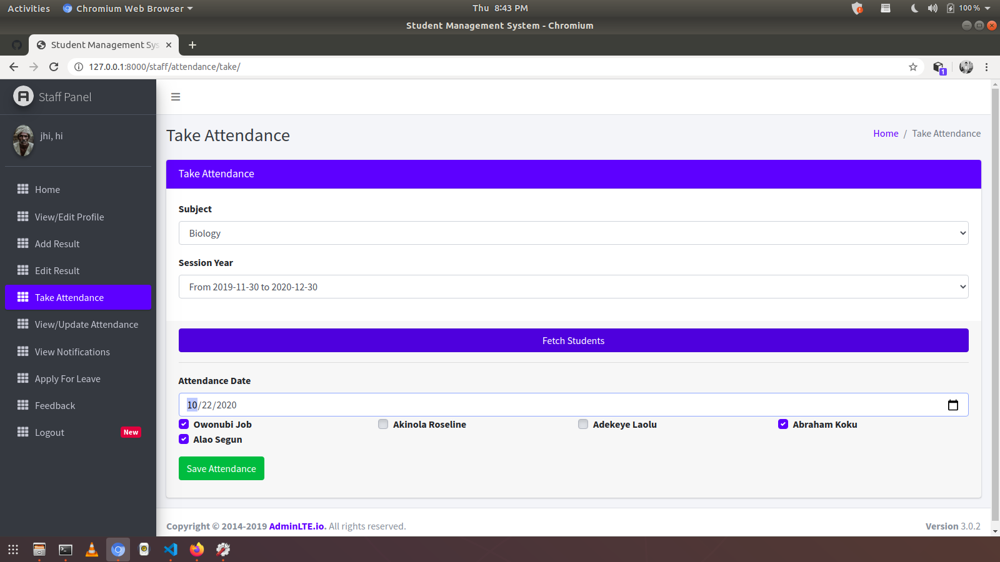
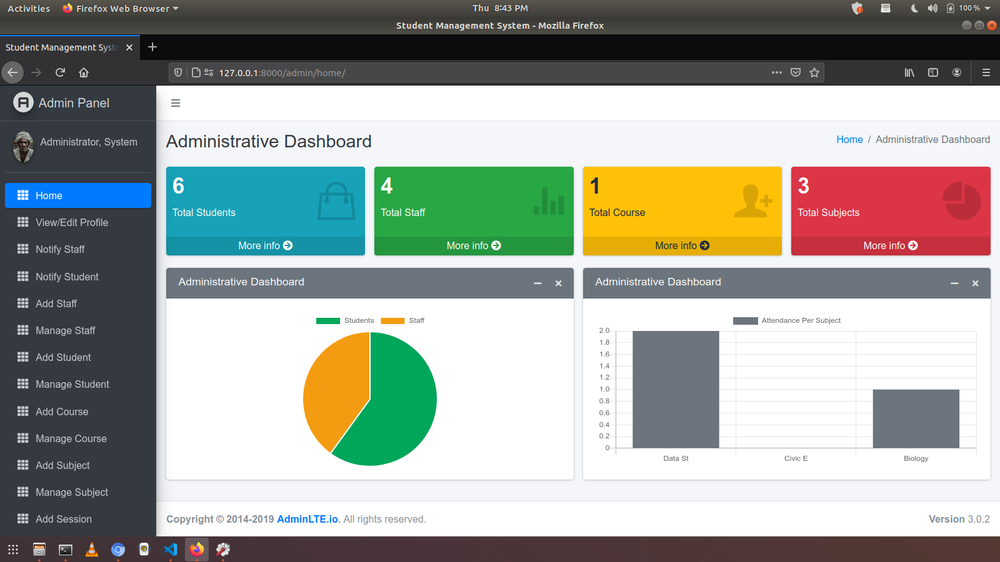
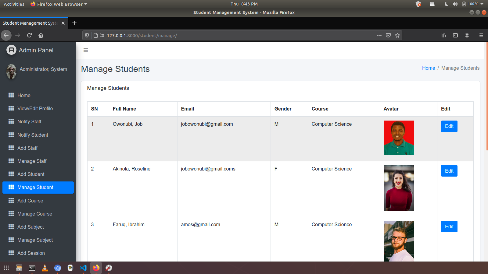
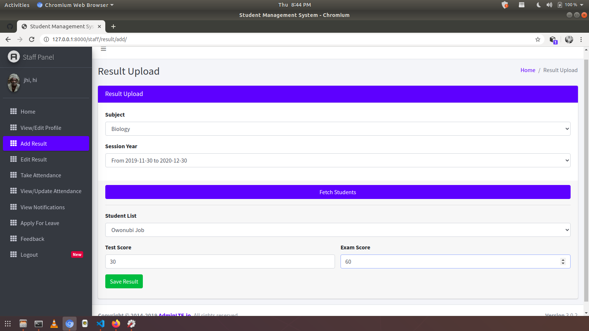
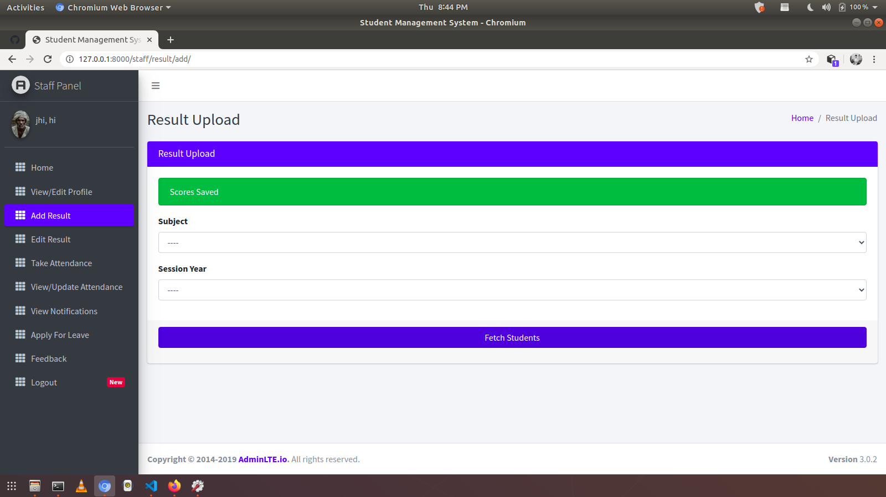

| Admin| Learner |
|------|---------|
|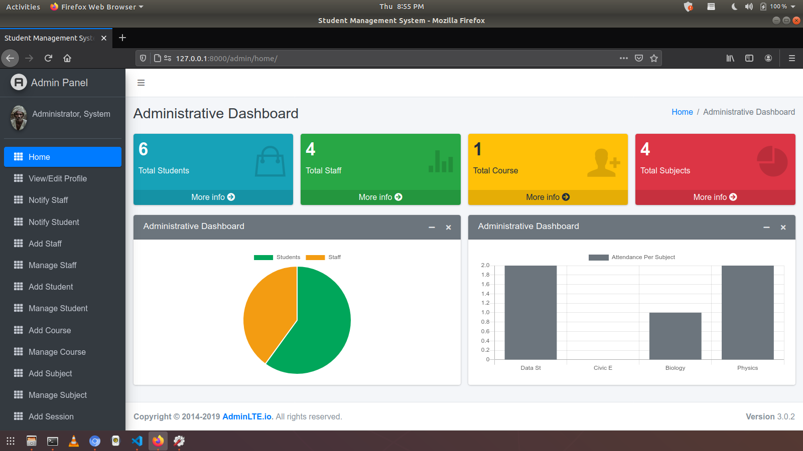|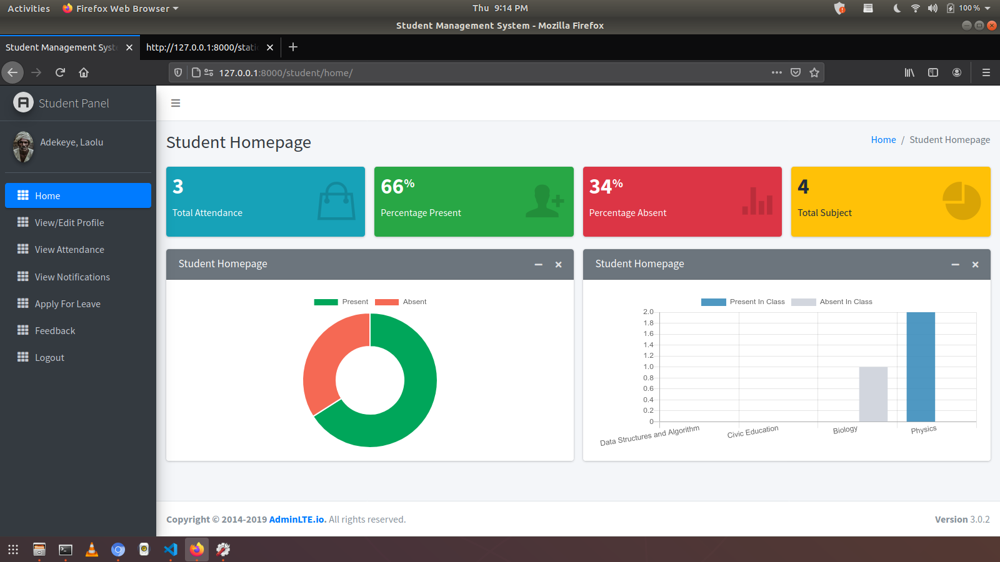|
|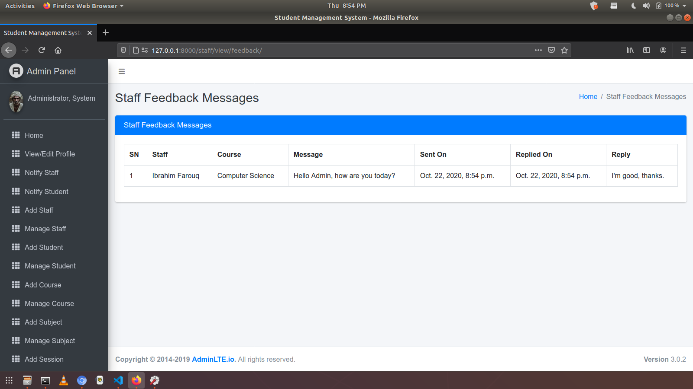|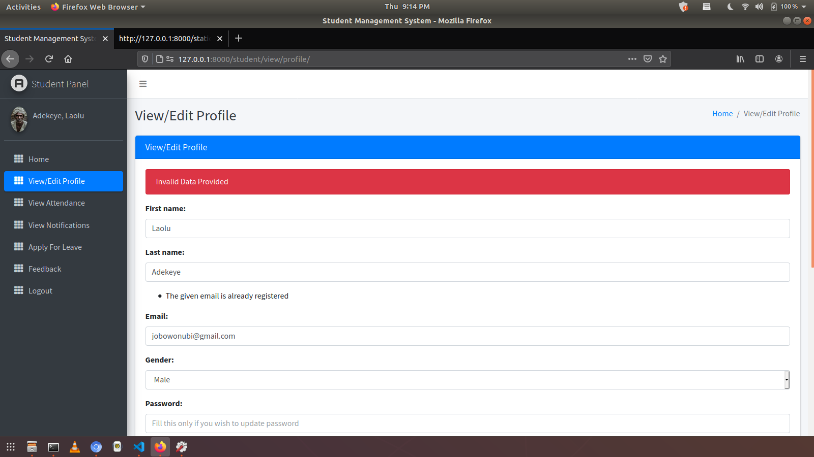|
|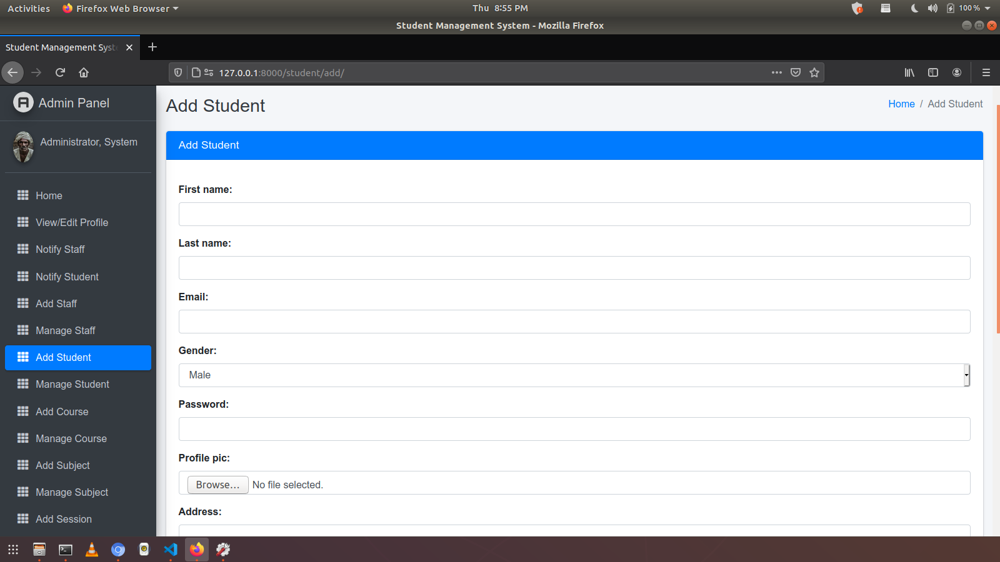|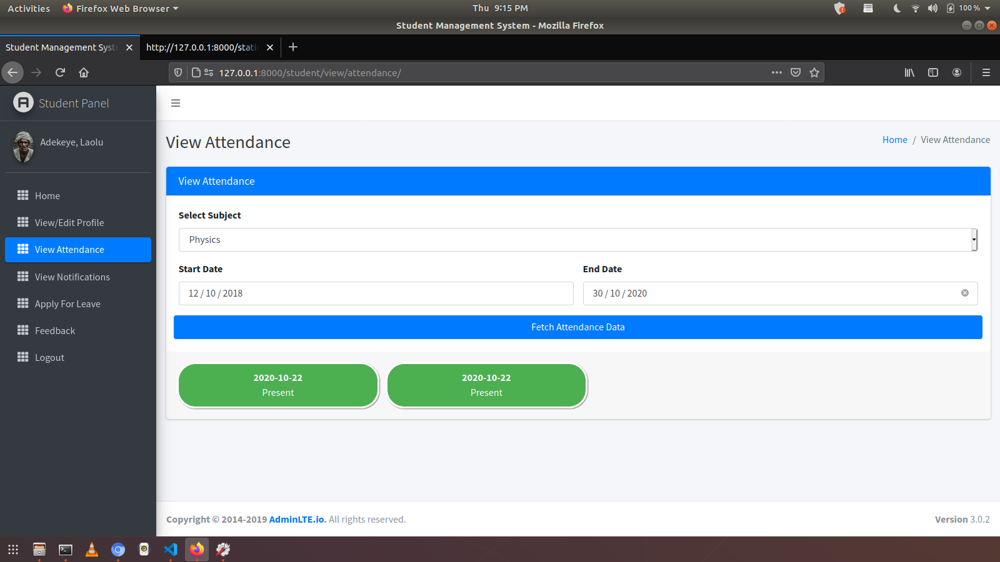|
|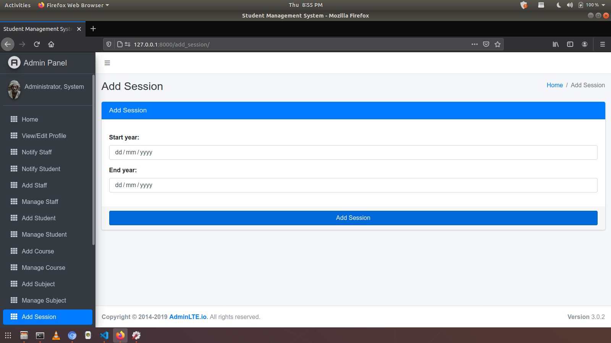|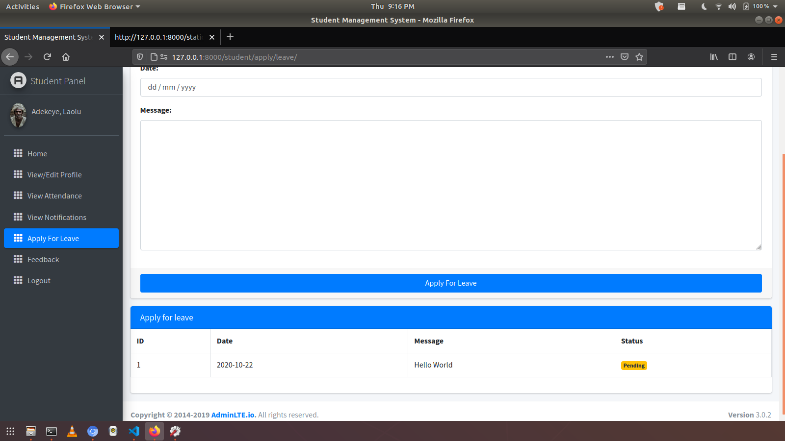|
|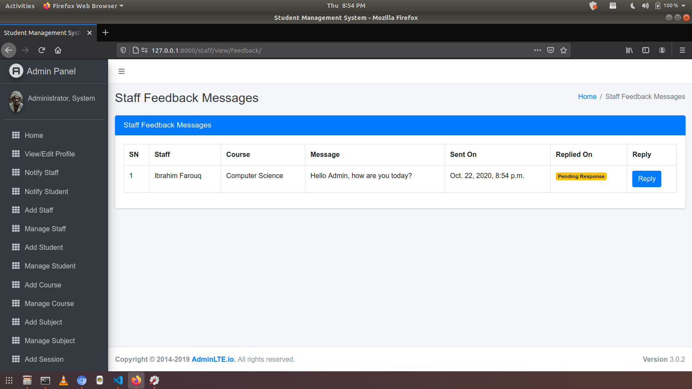|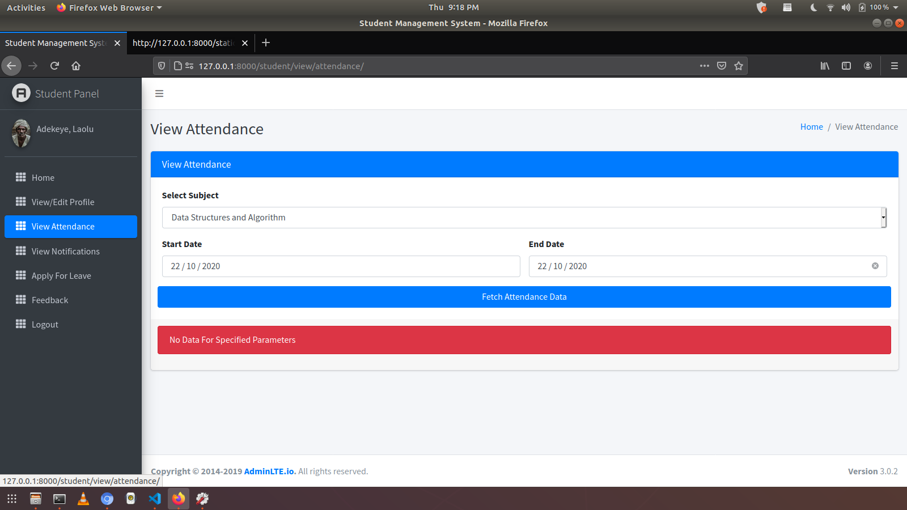|
|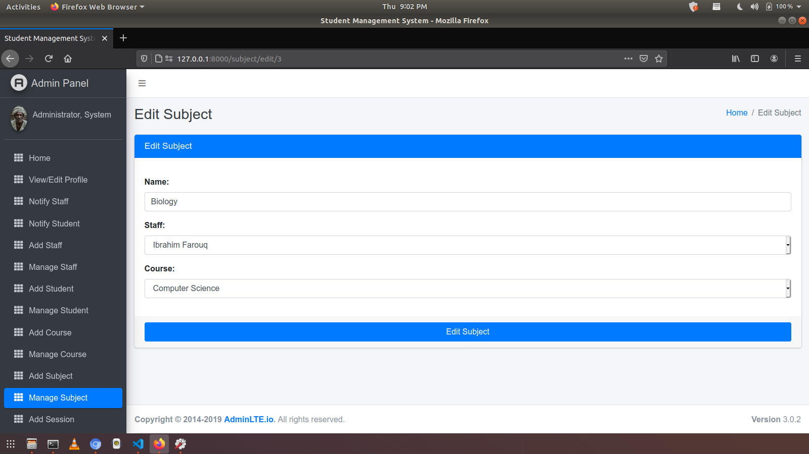||


## Support Developer
1. Add a Star 🌟  to this 👆 Repository
2. Follow on Twitter/Github


## Passport/Images
Images are from [Unsplash](https://unsplash.com)


## How to Install and Run this project?

### Pre-Requisites:
1. Install Git Version Control
[ https://git-scm.com/ ]

2. Install Python Latest Version
[ https://www.python.org/downloads/ ]

3. Install Pip (Package Manager)
[ https://pip.pypa.io/en/stable/installing/ ]

*Alternative to Pip is Homebrew*

### Installation
**1. Create a Folder where you want to save the project**

**2. Create a Virtual Environment and Activate**

Install Virtual Environment First
```
$  pip install virtualenv
```

Create Virtual Environment

For Windows
```
$  python -m venv venv
```
For Mac
```
$  python3 -m venv venv
```
For Linux
```
$  virtualenv .
```

Activate Virtual Environment

For Windows
```
$  source venv/scripts/activate
```

For Mac
```
$  source venv/bin/activate
```

For Linux
```
$  source bin/activate
```

**3. Clone this project**
```
$  git clone https://github.com/jobic10/student-management-using-django.git
```

Then, Enter the project
```
$  cd student-management-using-django
```

**4. Install Requirements from 'requirements.txt'**
```python
$  pip3 install -r requirements.txt
```

**5. Add the hosts**

- Got to settings.py file 
- Then, On allowed hosts, Use **[]** as your host. 
```python
ALLOWED_HOSTS = []
```
*Do not use the fault allowed settings in this repo. It has security risk!*


**6. Now Run Server**

Command for PC:
```python
$ python manage.py runserver
```

Command for Mac:
```python
$ python3 manage.py runserver
```

Command for Linux:
```python
$ python3 manage.py runserver
```

**7. Create Login Accounts**

Create an admin account and choose its password:
Command for PC:
```
$  python manage.py createsuperuser
```

Command for Mac:
```
$  python3 manage.py createsuperuser
```

Command for Linux:
```
$  python3 manage.py createsuperuser
```

There are no pre-seeded demo accounts. After logging into the Admin interface,
create learner accounts using **Add Learner** and set a password for each learner.


## For Sponsor or Projects Enquiry
1. Email - jobowonubi@gmail.com
2. LinkedIn - [jobic10](https://www.linkedin.com/in/jobic10 "Owonubi Job Sunday on LinkedIn")
2. Twitter - [jobic10](https://www.twitter.com/jobic10 "Owonubi Job Sunday on Twitter")


## Project's Journey
- [x] Admin/Learner Login
- [x] Add and Edit Learner
- [x] Add and Edit Subject
- [x] Upload Learner's Picture
- [x] Sidebar Active Status
- [x] Named URLs
- [x] Model Forms for adding learners
- [x] Model Forms for all
- [x] Views Permission (MiddleWareMixin)
- [x] Password Reset Via Email
- [x] Apply For Leave
- [x] Check Email Availability
- [x] Reply to Leave Applications
- [x] Reply to Feedback
- [x] Password Change for Admin and Learners using *set_password()*
- [x] Admin Profile Edit
- [x] Learner Profile Edit
- [x] Learner Dashboard Fixed
- [x] Passing Page Title From View  - Improved
- [x] Admin Dashboard Fixed
- [x] Firebase Web Push Notifications
- [x] Learner View Results
- [x] Change all links to be dynamic
- [x] Code Restructure - Very Important


## Questions I asked While Developing This
- https://stackoverflow.com/questions/63829896/is-there-a-specific-way-of-adding-apps-in-django/


## Helpful Links
- https://stackoverflow.com/questions/55969952/how-can-i-avoid-a-user-from-registering-an-already-used-email-in-django
- https://stackoverflow.com/questions/7562573/how-do-i-get-django-forms-to-show-the-html-required-attribute
- https://stackoverflow.com/questions/40910149/django-exists-versus-doesnotexist
- https://www.edureka.co/community/80982/how-can-i-have-multiple-models-in-a-single-django-modelform
- https://stackoverflow.com/questions/12848605/django-modelform-what-is-savecommit-false-used-for
- https://simpleisbetterthancomplex.com/tutorial/2018/01/18/how-to-implement-multiple-user-types-with-django.html
- https://stackoverflow.com/questions/32576348/how-can-i-create-django-modelform-for-an-abstract-model
- https://www.fomfus.com/articles/how-to-use-email-as-username-for-django-authentication-removing-the-username
- https://stackoverflow.com/questions/64145745/create-user-missing-1-required-positional-argument-username?noredirect=1#64145844
- https://stackoverflow.com/questions/36059194/what-is-the-difference-between-json-dump-and-json-dumps-in-python
- https://stackoverflow.com/questions/64188313/django-can-i-delete-apps-static-files-after-running-collectstatic/64189244#64189244
- https://stackoverflow.com/questions/29416478/change-form-field-value-before-saving
- https://support.google.com/mail/thread/38519529?hl=en
- https://stackoverflow.com/questions/46155/how-to-validate-an-email-address-in-javascript
- https://stackoverflow.com/questions/3429084/why-do-i-get-an-object-is-not-iterable-error
